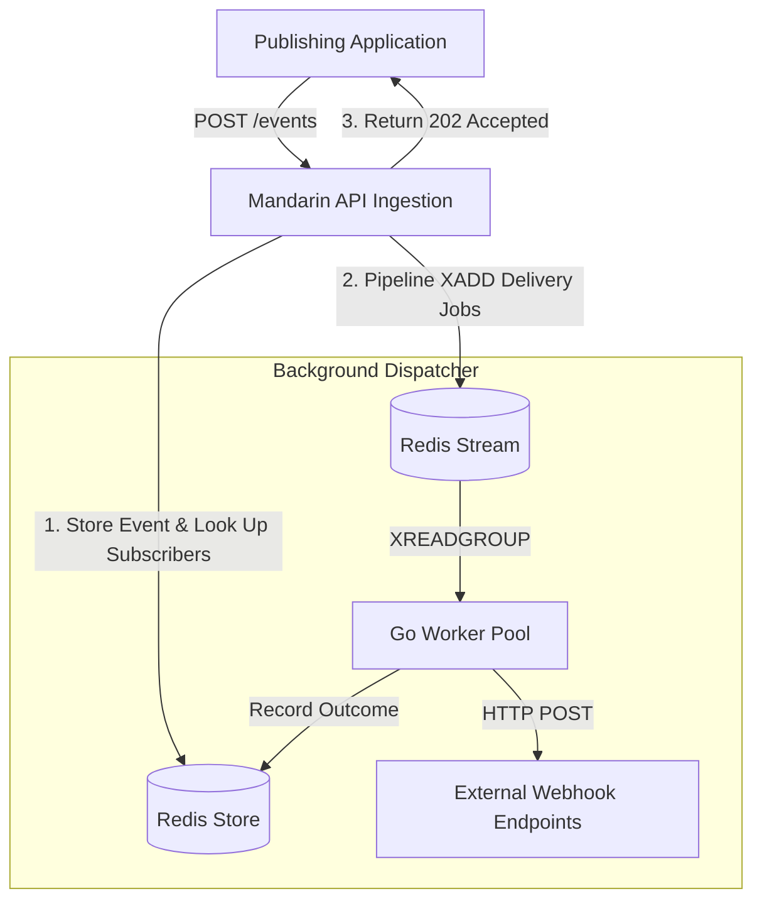
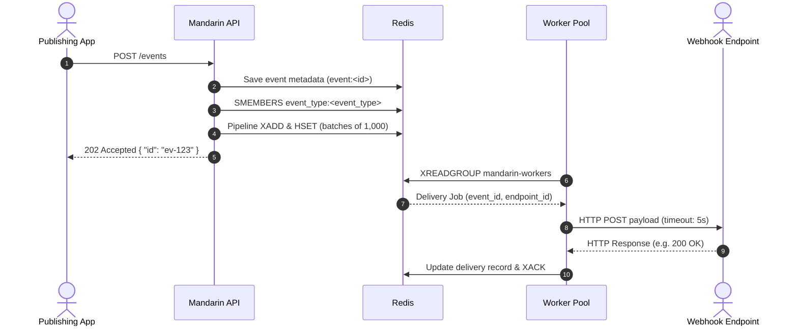

# Architecture and System Design

Mandarin is a lightweight, self-hosted webhook fan-out engine. Its job is simple: accept an event once through an HTTP API and asynchronously deliver that event to every registered webhook endpoint subscribed to that event type.

This document describes how Mandarin is designed, how data moves through the system, how Redis is used as both database and message queue, and how concurrency and shutdown are handled.

---

## 1. System Overview

Mandarin splits event ingestion from webhook delivery. When a client publishes an event, it does not wait for hundreds or thousands of external HTTP endpoints to respond. Instead, Mandarin records the event, schedules the work in Redis, and immediately returns `202 Accepted`.

A pool of background workers pulls pending deliveries from Redis and sends the HTTP requests concurrently.

### Core Architecture Rules

| Principle | Why Mandarin Follows It |
| --- | --- |
| **Decoupled Ingestion** | External webhooks are slow, unpredictable, and prone to timeouts. Decoupling ensures publishers always experience fast, constant-time ingestion latency. |
| **Stateless Application Layer** | All state lives in Redis. Mandarin instances do not hold delivery state in memory, allowing servers to restart or scale horizontally without data loss. |
| **Single Stateful Dependency** | Rather than requiring both a SQL database and a message broker (like Kafka or RabbitMQ), Mandarin uses Redis for entity storage, topic indexing, and message streaming. |
| **Standard Library Simplicity** | The HTTP layer is built with Go's standard `net/http` package and standard library primitives, minimizing external dependencies and maintenance overhead. |

---

## 2. Core Components

Rather than mirroring the filesystem, Mandarin's design is organized into four distinct logical layers:

| Layer | Responsibility | Primary Interactions |
| --- | --- | --- |
| **HTTP Routing & API** | Validates incoming JSON requests, enforces HTTP method constraints, and provides standard REST responses. | Interacts with HTTP clients and passes parsed input to the Storage layer. |
| **Storage & Data Access** | Encapsulates all Redis commands, key formatting, pipelining, and transactional multi-key lookups. | Interacts directly with the Redis server instance. |
| **Dispatcher & Worker Pool** | Runs background goroutines that pull delivery jobs from Redis Streams and make outbound HTTP POST requests. | Reads from Redis Streams and writes status updates back to Redis Hashes. |
| **Application Lifecycle** | Parses configuration (YAML + environment variables), verifies connectivity on startup, and coordinates graceful shutdown. | Manages the HTTP server server and worker pool context lifecycles. |

---

## 3. Redis Data Model

Mandarin uses specific Redis data types to optimize for read performance, secondary indexing, and queue delivery:

| Key Pattern | Redis Type | Purpose | Example Value / Fields |
| --- | --- | --- | --- |
| `endpoint:<id>` | **Hash** | Stores endpoint metadata and target URL. | `id`, `url`, `created_at` |
| `endpoints:all` | **Set** | Global registry of all active endpoint IDs. | Set of IDs: `{"ep-101", "ep-102"}` |
| `event_type:<name>` | **Set** | Topic index linking an event type to subscribed endpoint IDs. | Set of IDs subscribed to `order.completed` |
| `subscriptions:<endpoint_id>` | **Set** | Reverse index tracking all event types an endpoint subscribes to. | Set of event names subscribed to by that endpoint |
| `event:<id>` | **Hash** | Immutable event payload and creation timestamp. | `id`, `event_type`, `payload`, `published_at` |
| `mandarin:deliveries` | **Stream** | Append-only job queue consumed by workers. | Stream entries containing `event_id` and `endpoint_id` |
| `delivery:<event_id>:<endpoint_id>` | **Hash** | Telemetry and status record for a specific delivery attempt. | `status`, `http_status`, `duration_ms`, `attempted_at` |
| `event_deliveries:<event_id>` | **Set** | Index of all endpoint IDs associated with an event. | Set of endpoint IDs scheduled for that event |

### Why This Key Design Works
1. **$O(1)$ Subscriber Lookups**: Finding who needs an event does not require scanning tables or full-database queries. Mandarin issues `SMEMBERS event_type:<name>`, returning all subscriber IDs directly from in-memory set indexes.
2. **Clean Disconnection**: The reverse index `subscriptions:<endpoint_id>` allows Mandarin to clean up all topic registrations instantly when an endpoint is deleted.

---

## 4. The Event Lifecycle: From Ingest to Webhook Delivery

Every published event travels through a five-stage pipeline:

### Stage 1: Validation and Storage
The API receives `POST /events` with an event type string and JSON payload. It validates that both fields are present and creates an event record in Redis under `event:<id>`.

### Stage 2: Subscriber Resolution
Mandarin queries the Redis Set `event_type:<name>`. If no endpoints are subscribed to that event type, Mandarin returns `202 Accepted` immediately with 0 scheduled deliveries.

### Stage 3: Pipelined Dispatch
When subscribers exist, Mandarin must do two things for each subscriber:
1. Create a delivery record hash initialized to `status: pending`.
2. Push a delivery task onto the stream `mandarin:deliveries`.

If an event matches 10,000 subscribers, executing these commands individually would require 20,000 round-trips over the network. Mandarin chunks subscribers into batches (default: 1,000) and executes each batch via a **Redis Pipeline**. This bundles hundreds of operations into a single TCP packet, completing 10,000 dispatches in under a second while preventing Redis's event loop from stalling.

### Stage 4: Worker Consumption
Worker goroutines query the stream using `XREADGROUP` under the consumer group `mandarin-workers`:
- Consumer groups guarantee that each delivery job is handed to exactly one worker.
- Multiple worker goroutines process items concurrently.
- If multiple Mandarin instances run side-by-side, Redis automatically balances delivery jobs across all instances.

### Stage 5: HTTP Delivery & Status Recording
The assigned worker:
1. Fetches the endpoint's target URL.
2. Formats the webhook payload with the event ID, event type, timestamp, and original data.
3. Performs an HTTP `POST` with a configurable timeout (default: 5 seconds).
4. Records the outcome (`success` for 2xx status codes, `failed` for timeouts or non-2xx codes) along with the execution duration in milliseconds.
5. Acknowledges the stream message with `XACK`.

---

## 5. Concurrency and Worker Pool Design

Mandarin uses a bounded worker pool rather than spawning an unconstrained goroutine for every delivery:

| Aspect | Implementation | Design Rationale |
| --- | --- | --- |
| **Worker Count** | Configured via `workers` setting (default: `10`). | Prevents socket exhaustion and local CPU thrashing during sudden 100k fan-out spikes. |
| **Stream Blocking** | Workers block on `XREADGROUP` using a 2-second block timeout. | Avoids busy-waiting CPU loops when the delivery stream is empty. |
| **HTTP Client** | Shared `http.Client` with connection pooling (`MaxIdleConns: 100`). | Reuses existing TCP sockets for frequently hit subscriber domains. |
| **Per-Request Timeout** | Enforced via `context.WithTimeout` on outbound requests. | Guarantees that hanging subscriber servers cannot indefinitely freeze worker goroutines. |

---

## 6. Graceful Shutdown

When Mandarin receives an OS termination signal (`SIGINT` / `Ctrl+C` or `SIGTERM`), it executes an orderly shutdown:

1. **Stop Accepting New Ingestion**: The HTTP server halts new incoming requests using `server.Shutdown(ctx)`, allowing active client requests up to 30 seconds to finish.
2. **Signal Workers**: The root application context is cancelled, signaling worker loops to stop reading new messages from Redis Streams.
3. **Finish In-Flight Deliveries**: Workers finish any HTTP requests currently in progress before terminating their loops.
4. **Close Redis Connection**: Once all workers have exited and the HTTP server is closed, the Redis connection client is closed cleanly.

---

## Related Documentation

- [Setup and Development](setup.md) — Local setup, testing, configuration reference, and benchmark execution.
- [Design Decisions and Trade-offs](decision.md) — Architectural compromises, current boundaries, and design rationale.
